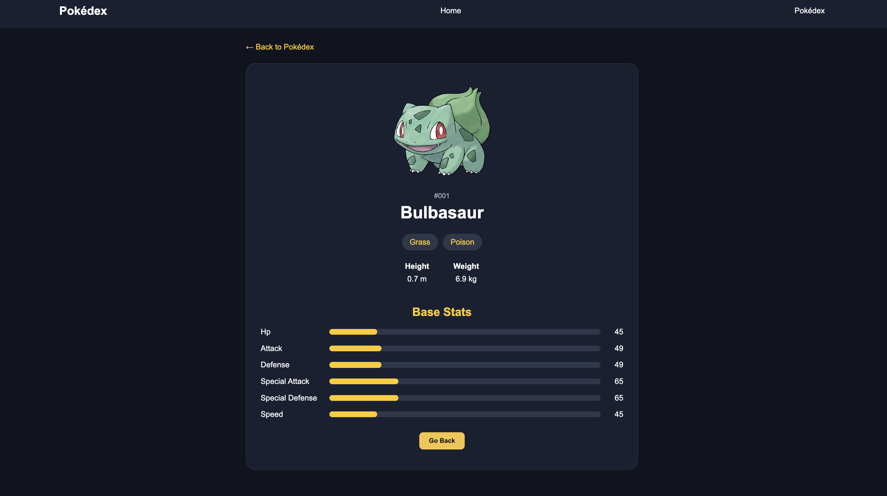
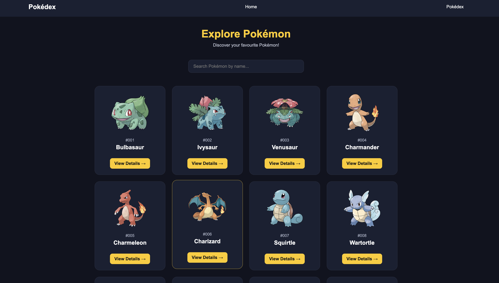

# 🎮 PS3 Pokédex

A responsive Pokémon explorer built with React that lets users browse Pokémon, search by name, and view detailed information about each Pokémon using the PokéAPI.

## ✨ Features

- 🏠 **Home Page:** A welcoming homepage with a link to explore Pokémon.
- 🔍 **Search Pokémon:** Search Pokémon by name.
- 🃏 **Pokémon Cards:** View Pokémon names, images, and numbers.
- 📊 **Detailed Information:** View Pokémon types, height, weight, and base stats.
- 🔄 **Loading & Error Handling:** Displays loading states, error messages, and a Try Again button.
- 🧭 **Navigation:** Navigate between pages using React Router.
- 🚫 **404 Page:** Shows a Not Found page for invalid routes.
- 📱 **Responsive Design:** Works on desktop and mobile screens.

## 🛠️ Technologies Used

- React
- JavaScript
- Vite
- React Router DOM
- HTML5
- CSS3
- [PokéAPI](https://pokeapi.co/)

## 📂 Project Structure

ps3-pokedex/
├── public/
├── src/
│   ├── components/
│   │   ├── Navbar.jsx
│   │   ├── PokemonCard.jsx
│   │   ├── PokemonDetails.jsx
│   │   └── PokemonList.jsx
│   ├── App.jsx
│   ├── App.css
│   ├── index.css
│   └── main.jsx
├── index.html
├── package.json
├── package-lock.json
└── README.md

## 🚀 Getting Started

### Prerequisites

- Node.js and npm installed on your computer.
- An internet connection to fetch Pokémon data.

### Installation

1. Clone the repository:

  
   git clone https://github.com/anjalimishra-0007/ASS-4-ps-3-pokedex.git
 

2. Navigate to the project directory:

  
   cd ps3-pokedex
  

3. Install dependencies:

   
   npm install
  

4. Start the development server:

  
   npm run dev
  

5. Open the local URL shown in your terminal.

### Build for Production

npm run build

## 🧭 Application Routes

| Route | Description |
|---|---|
| `/` | Homepage |
| `/pokemon` | Pokémon list and search |
| `/pokemon/:name` | Details of a selected Pokémon |
| `*` | Not Found page |

## 🌐 API Used

This project uses the public [PokéAPI](https://pokeapi.co/) to retrieve Pokémon information.

**Pokémon list endpoint:**

https://pokeapi.co/api/v2/pokemon?limit=50

**Individual Pokémon endpoint:**

https://pokeapi.co/api/v2/pokemon/{name}

## 📸 Screenshots

Add screenshots of your actual application here.

### Home Page

### Pokémon Details Page

### Additional Screenshot

## 🔗 Live Demo

**Live Website:** https://ass-4-ps-3-pokedex.vercel.app/

## 👩‍💻 Author

Anjali Mishra
---

Made with ❤️ using React and PokéAPI.
